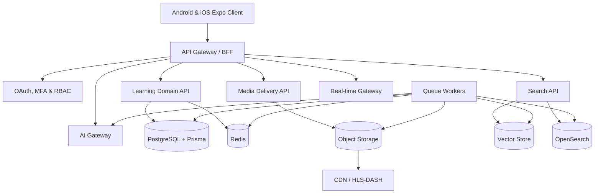
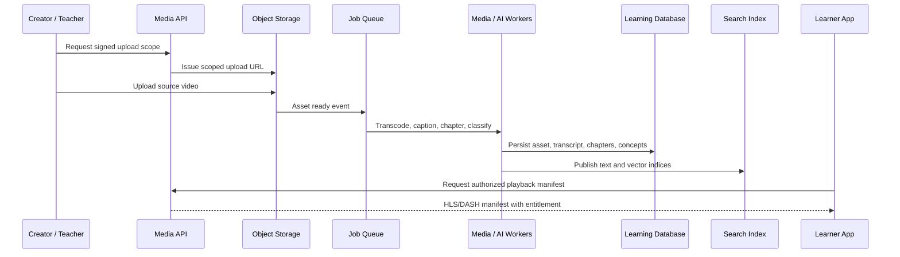

# LearnVerse AI Architecture

## Executive Summary

LearnVerse AI is designed as a **mobile learning client plus platform services**, rather than a video feed. Its core product loop is **discover → watch → understand → practice → apply → measure → improve**. The Android/iOS app in this repository owns presentation, mobile navigation, device-safe local learning state, accessibility, and typed API consumption. The commercial platform behind it is separated into API, AI gateway, media pipeline, search, analytics, notification, and real-time collaboration capabilities.

> **Delivery boundary:** this repository implements the student-facing mobile product and service contracts. The large-scale ingestion, worker, semantic-search, revenue, and institution operations in the source requirements require independently deployed services and must not be faked in the mobile client.

## Logical Architecture



## Service Responsibilities

| Service | Responsibility | Data ownership |
|---|---|---|
| Mobile client | Native UI, accessibility, offline study cache, local draft state, playback controls, and typed API client | Device-local state only; secrets never reside here. |
| API gateway/BFF | Versioned REST endpoints and mobile-oriented aggregation | No source of truth; validates tokens, scope, and request limits. |
| Learning domain API | Courses, lessons, assessments, progress, portfolios, and organization membership | Core relational records in PostgreSQL. |
| AI Gateway | Provider routing, prompt versioning, grounding retrieval, safety policy, token accounting, and response normalization | Provider configuration and usage audit metadata. |
| Media service | Signed upload authorization, transcoding job orchestration, asset manifests, caption access, and rights checks | Asset metadata in PostgreSQL; binary media in object storage. |
| Search service | Text, facet, transcript, and semantic retrieval | Search index and embeddings, derived from authoritative content. |
| Worker tier | Transcription, chapter extraction, material generation, indexing, analytics aggregation, notification delivery, and moderation | Idempotent job state in Redis/PostgreSQL. |
| Real-time gateway | Study room presence, chat, collaborative notes, polls, and live quiz updates | Ephemeral room state in Redis; durable events in PostgreSQL. |

## AI Gateway Contract

The AI Gateway owns provider selection and keeps provider credentials on the server. Requests are task-oriented rather than provider-oriented: `tutor.answer`, `material.summarize`, `assessment.generate`, `embedding.create`, `speech.transcribe`, and `speech.synthesize`. Every educational answer must carry a content-grounding status and citations where source material is available; the user interface must show uncertainty rather than inventing evidence.

## Media Ingestion and Learning-Material Flow



## Mobile Client Structure

The current Expo project is organized around routes, reusable learning components, local state hooks, shared domain types, and service adapters. `app/` contains route composition only. Domain rules such as adaptive question selection, spaced-repetition scheduling, and learning-event serialization belong in `lib/learning/` or server handlers rather than screen components. Server-provided AI runs only through typed endpoints; the client never imports provider keys.

```text
app/                 # Expo Router route composition
components/          # Reusable native UI and learning modules
lib/learning/        # Pure learning-domain functions and local adapters
lib/services/        # Typed client-side service adapters
shared/              # Cross-boundary DTOs and validation schemas
server/              # Current mobile BFF / tRPC server adapters
docs/                # Product and operational documentation when needed
```

## MVP Versus Expansion

| Scope | Included in this mobile delivery | Required platform evolution |
|---|---|---|
| Learner experience | Home, discovery, learning path, lesson video, chapters, contextual tutor UI, notes, flashcards, adaptive practice, progress, and locally persisted study state | Account sync, offline media entitlement, translated content, certificates, and portfolios. |
| Content platform | Typed content contracts and media/AI integration boundaries | Teacher upload, moderation, transcoding, CDN, rights controls, and creator analytics. |
| AI | Server-side tutor adapter and grounded-context request model | Multi-provider routing, retrieval augmentation, usage limits, policy enforcement, and asynchronous material generation. |
| Collaboration | Intentional product boundary | WebSocket study rooms, whiteboards, shared notes, presence, and abuse reporting. |
| Organizations and billing | Intentional product boundary | Multi-tenancy, institutional RBAC, payment abstraction, invoices, feature entitlement, and audit trails. |

## Implementation Decisions

The long-term target remains **PostgreSQL with Prisma**, Redis, object storage, a CDN, a vector-capable retrieval layer, and worker queues as requested. The initialized mobile template currently includes a server and MySQL-compatible Drizzle capability; this client deliberately keeps its persistence and API interfaces isolated so that the production backend can be introduced without redesigning native screens. Local persistence is used only for learner-owned device state until authenticated multi-device synchronization is enabled.
