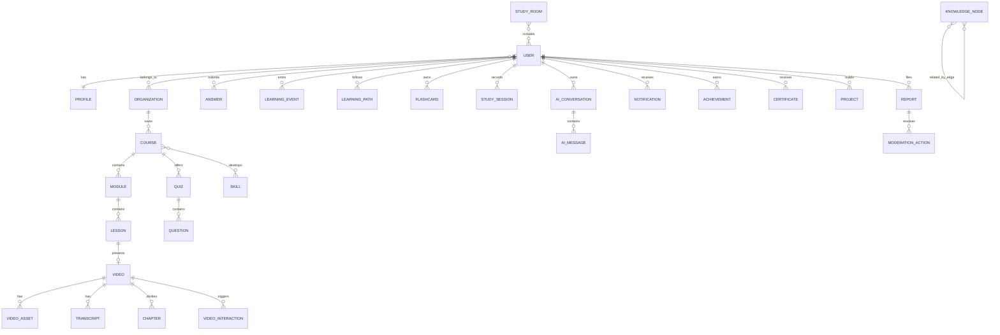

# LearnVerse AI Data Model

## Data Strategy

Production data is normalized in PostgreSQL and accessed through Prisma. Large video, audio, thumbnail, caption, and generated-export binaries are stored in object storage; relational tables retain immutable asset keys, ownership, policy, and derived metadata. The mobile app does not treat local state as the authoritative record when the learner is signed in.

## Relationship Map

## Core Aggregate Tables

| Aggregate | Principal tables | Integrity and index notes |
|---|---|---|
| Identity and tenancy | `User`, `Profile`, `Role`, `Permission`, `Organization`, `OrganizationMember` | Unique identity provider subject; scoped `(organizationId, userId)` membership; permission grants audited. |
| Content | `Course`, `Module`, `Lesson`, `Video`, `VideoAsset`, `Transcript`, `Chapter`, `Playlist`, `Comment`, `Bookmark` | Stable UUID public identifiers; ordered module/lesson positions; composite indexes for visible content, course order, and transcript timestamp lookup. |
| Assessment | `Quiz`, `Question`, `Answer`, `Assignment`, `Submission`, `VideoInteraction` | Version quiz questions; record scoring explanation and concept tags separately from learner responses. |
| Learning state | `LearningPath`, `LearningEvent`, `StudySession`, `Flashcard`, `Skill`, `SkillAssessment`, `Recommendation`, `Achievement`, `Certificate`, `Project` | Append-only learning events; indexes on `(userId, occurredAt)` and `(userId, conceptId, dueAt)` for progress and spaced repetition. |
| Knowledge and AI | `KnowledgeNode`, `KnowledgeEdge`, `AIConversation`, `AIMessage`, `AIEmbedding` | Embeddings are derived data, carry model/version fields, and preserve a source content revision. |
| Commercial and trust | `Subscription`, `Payment`, `Report`, `ModerationAction`, `AuditLog`, `Notification` | Payment-provider external IDs unique; moderation decisions and privileged actions are immutable audit events. |
| Social learning | `StudyRoom`, `StudyRoomMember`, `SharedNote`, `Poll`, `PresenceEvent` | Room visibility and organization scope enforced in every query; ephemeral presence remains outside the primary database. |

## Suggested Production Prisma Entities

The following entity sequence enables incremental delivery without destabilizing the schema:

| Release sequence | Entities | Purpose |
|---|---|---|
| Foundation | `User`, `Profile`, `Organization`, `Role`, `Permission`, `Course`, `Module`, `Lesson`, `Video`, `VideoAsset` | Identity, entitlement, owned content, and lesson delivery. |
| Learning | `Transcript`, `Chapter`, `VideoInteraction`, `Quiz`, `Question`, `Answer`, `LearningEvent`, `LearningPath`, `Flashcard`, `StudySession` | Interactive learning and verifiable progress. |
| Intelligence | `KnowledgeNode`, `KnowledgeEdge`, `AIConversation`, `AIMessage`, `AIEmbedding`, `Recommendation`, `SkillAssessment` | Grounded personalization and concept retrieval. |
| Collaboration | `StudyRoom`, `StudyRoomMember`, `SharedNote`, `Comment`, `Poll`, `Notification` | Real-time learning relationships. |
| Governance | `Subscription`, `Payment`, `Report`, `ModerationAction`, `AuditLog`, `Certificate`, `Project` | Monetization, safety, compliance, and learner credentials. |

## Authoritative Events

Learning behavior is captured as intentionally minimal, typed events: `VIDEO_STARTED`, `VIDEO_COMPLETED`, `CHAPTER_COMPLETED`, `QUESTION_ANSWERED`, `QUIZ_COMPLETED`, `COURSE_COMPLETED`, `CONCEPT_MASTERED`, `FLASHCARD_REVIEWED`, and `STUDY_SESSION_STARTED`. Event payloads hold object references and the smallest evidence needed for learning calculations; raw personal content is not duplicated in analytics events.

## Data Retention and Privacy

The data model supports policy-based retention and deletion with ownership-aware foreign keys. AI prompts, transcript segments, and generated materials must record their source, generation model, policy version, and visibility scope. Local mobile storage contains only the current device's learner state and can be cleared from the profile surface; production deletion is completed by a server-side, auditable workflow.
